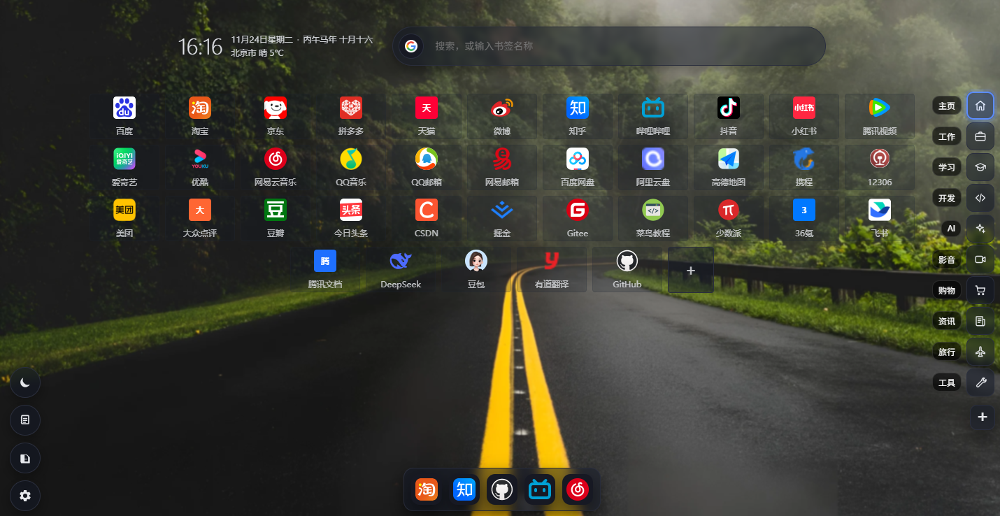
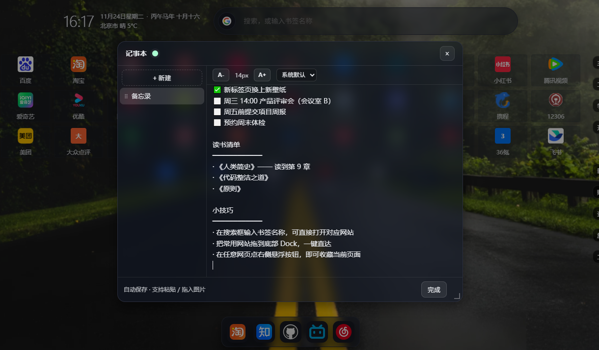
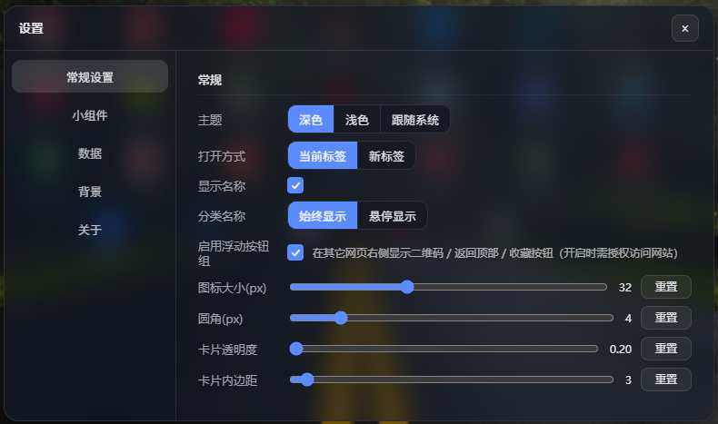

<div align="center">


# GCE启动器

把新标签页变成你的个人起始页：多引擎搜索、书签网格、Dock、记事本、网页悬浮工具。

数据只保存在你自己的浏览器里，不上传、不追踪。

[](https://github.com/powerglq/gce/actions/workflows/ci.yml)


[](LICENSE)

</div>



<table>
  <tr>
    <td></td>
    <td></td>
  </tr>
</table>

## ✨ 功能

| 功能 | 说明 |
|------|------|
| 🔍 **多引擎搜索** | 百度 / Google / DuckDuckGo / Yandex，一键切换；输入时联想匹配的书签 |
| 📚 **书签网格** | 分组管理、拖拽排序；图标可自动获取 / 纯色 / 本地上传，卡片菜单可「获取图标」 |
| 🗂️ **分组侧栏** | 55 个分类图标；点击或滚轮切换分组，带方向过渡动画；拖拽书签到分组即可移动 |
| 📌 **Dock 快捷栏** | 底部固定常用链接：拖入固定、拖出移除、拖拽排序 |
| 📝 **记事本** | 多条笔记、粘贴 / 拖入图片、字号与字体调节、自动保存 |
| 🌐 **网页悬浮按钮** | 在任意网页收藏当前页（自动获取图标）、生成二维码、返回顶部；毛玻璃样式，可拖动位置 |
| 🖼️ **背景** | 本地或远程图片（自动压缩），遮罩、模糊、位置、填充可调 |
| 🕒 **小组件** | 时钟、日期与星期、农历、天气，在设置中分别开关 |
| 🌗 **主题** | 深色 / 浅色 / 跟随系统 |
| 💾 **备份** | JSON 导入导出，可按类别选择；兼容旧版 WeTab 备份与手机 Nav 分享数据 |

## 📦 安装

**从源码安装**（需要 Node.js，版本见 [`.nvmrc`](.nvmrc)）：

```bash
git clone https://github.com/powerglq/gce.git
cd gce
npm install
npm run build
```

国内访问 GitHub 较慢时，可从 Gitee 镜像克隆：`git clone https://gitee.com/coolteam/gce.git`（代码与 GitHub 同步；Issue 与 Pull Request 请提交到 GitHub）。

1. 打开 `chrome://extensions/`（Edge 为 `edge://extensions/`）
2. 开启右上角「开发者模式」
3. 点击「加载已解压的扩展程序」，选择项目中的 `extension/` 目录

打开一个新标签页即可使用。

## 💡 使用技巧

- **切换分组**：点击右侧分组图标；或在页面顶部 / 底部继续滚动鼠标滚轮、触控板双指上下滑
- **固定到 Dock**：把书签拖到底部 Dock；从 Dock 拖出即取消固定。也可以把浏览器地址栏或网页中的链接直接拖进 Dock
- **移动书签**：把书签拖到右侧的目标分组上
- **编辑 / 删除**：在书签上点右键，或点卡片右上角的「⋯」
- **分组管理**：在分组图标上点右键可编辑、删除，或「更新图标」批量重新获取该分类下的网站图标；设置中可选择分类名称「始终显示 / 悬停显示」
- **切换主题**：点击左下角记事本上方的按钮，在深色 → 浅色 → 跟随系统之间循环
- **搜索书签**：在搜索框输入书签名称或网址，用 ↑ ↓ 选择、回车打开

## 🔒 隐私与权限

数据保存在浏览器本地（`chrome.storage.local` 与 IndexedDB），项目没有任何服务器，不收集任何使用数据。

| 权限 | 用途 |
|------|------|
| `storage` / `unlimitedStorage` | 在本地保存书签、笔记、设置与背景图 |
| `favicon` | 读取浏览器已缓存的网站图标（不联网） |
| `scripting` | 开启悬浮按钮后在网页中注册悬浮按钮脚本 |
| 访问所有 `http` / `https` 网站（可选） | 安装时不申请；开启悬浮按钮时才申请，关闭时归还。授权期间获取图标与标题会请求该网站 |

只有以下情况会联网（除天气外只请求相关网站本身）：获取网站图标 / 标题（需已授权访问网站）、获取搜索引擎图标、下载你指定的远程背景图、显示导入数据中的远程图片；开启天气小组件后，向 Open-Meteo 发送所选城市的经纬度。详见 [隐私说明](PRIVACY.md)。

## 🛠️ 开发

```bash
npm install
npm run check          # 类型检查 + Lint + 单元测试（提交前必跑）
npm run build          # 构建新标签页 → extension/newtab-build/
npm run build:all      # 发布包 → extension/newtab-build-chrome/、newtab-build-edge/
npm run dev            # 监听构建并启动一个调试用 Chrome
npm run setup:hooks    # 启用提交前检查（拦截密钥等敏感文件）
```

项目结构、数据存储与写入规则见 [贡献指南](CONTRIBUTING.md)。

## 🤝 参与贡献

欢迎提交 [Issue](https://github.com/powerglq/gce/issues) 与 Pull Request，开始前请先阅读 [贡献指南](CONTRIBUTING.md)。发现安全问题请按 [安全策略](SECURITY.md) 私下报告。

## 📄 许可证

[MIT](LICENSE)。使用的第三方代码及其许可证见 [THIRD_PARTY_NOTICES.md](THIRD_PARTY_NOTICES.md)。
